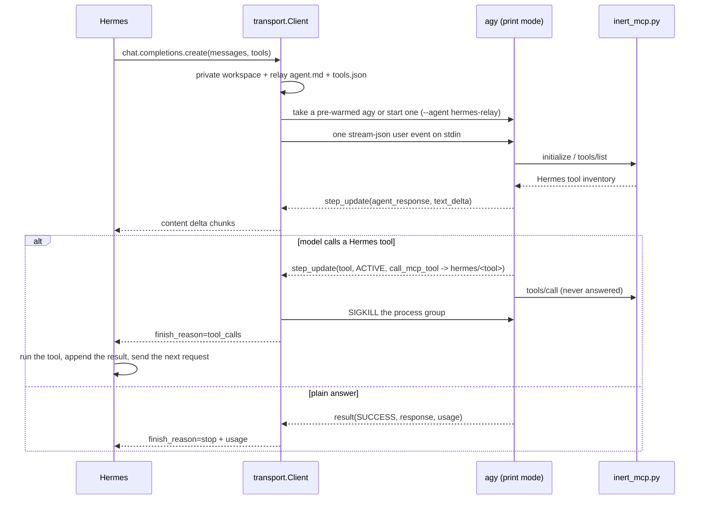

# Design

This document explains how `antigravity-agy` works, the measurements behind each decision, and the known limitations. Performance data is in [perf.md](perf.md).

All measurements were taken with Hermes Agent v0.21.4–v0.21.5, `agy` 1.2.10–1.2.11 on Linux, mostly with `gemini-3.8-flash-low`.

## 1. Overview

The plugin makes the official, already-signed-in `agy` CLI a Hermes model backend. The core invariant is the same as in Nous Research's `claude-subscription-directsdk` plugin: **agy is only the model; Hermes executes every tool.**

Each Hermes chat-completions request is served by one `agy` print-mode process that receives exactly one prompt. Requests that carry tools also pre-start up to `ANTIGRAVITY_AGY_PREWARM` (default 2) spare agy processes for the next request of the same shape. A spare receives nothing on stdin until a request takes it over, so it holds no conversation state (see [section 3.9](#39-performance-pre-warming-and-background-shutdown)).

## 2. Modules

| File               | Responsibility                                                                                               |
| ------------------ | ------------------------------------------------------------------------------------------------------------ |
| `plugin.yaml`      | Manifest (`kind: model-provider`); Hermes discovers `$HERMES_HOME/plugins/<name>/` automatically             |
| `__init__.py`      | `ProviderProfile` (`auth_type='external_process'`, `api_mode='chat_completions'`) and `register_provider()`  |
| `transport.py`     | Request path: relay agent, history flattening, NDJSON relay, tool-call capture, pre-warm pool, error mapping |
| `inert_mcp.py`     | Inventory-only MCP server: answers `tools/list`, records `tools/call` and never answers it                   |
| `agy_setup.py`     | Quota-free probes: `agy models` (model discovery) and `agy -p=/quota` (sign-in and quota state)              |
| `model_catalog.py` | Fallback model list, aliases, bare-family mapping, per-family context windows, `model_capabilities`          |

## 3. Design decisions and evidence

### 3.1 Turning off agy's built-in tools: a Markdown custom agent

agy supports custom agents defined in `.agents/agents/<name>/agent.md` inside the workspace (YAML frontmatter plus a Markdown body that becomes the system prompt), selected with `--agent <name>`. `transport.agent_markdown()` writes:

- `excludeDefaultComponents: true`: drops agy's default prompt sections and built-in tools.
- `inheritMcp: false`: none of the user's global MCP servers are loaded.
- `mainAgent: true`: **required**. Without it `--agent` does not find the agent.
- `mcpServers` as a **list of objects** (`- name: hermes`, `command`, `args`). A map or a list of paths makes the definition fail to parse.

Measured with a short prompt:

| Configuration                                  | Tools the model can call                                          | Base input tokens |
| ---------------------------------------------- | ----------------------------------------------------------------- | ----------------- |
| agy default agent                              | 17 (`view_file`, `run_command`, `write_to_file`, …)               | 24,749            |
| relay agent (`excludeDefaultComponents: true`) | `call_mcp_tool`, `list_resources`, `read_resource`, `manage_task` | ~1,000–1,230      |

The four remaining "fundamental" tools cannot be removed from frontmatter (`tools: [call_mcp_tool]` fails with `tool "call_mcp_tool" not found in registry`). They only list/kill background tasks or read MCP resources and cannot write files or run commands; the transport still treats any use of them as a violation ([3.4](#34-violations)).

### 3.2 agy silently falls back to its default agent

**Safety finding.** When `agent.md` fails to parse, agy only logs `Agent "hermes-relay" not found, falling back to default`; the stream-json `init` event still says `agent: hermes-relay`, and the run continues with the default agent, which then executed its built-in `view_file` on its own during testing. The plugin therefore:

1. Points `--log-file` at a private per-run log and checks it for the fallback marker at the `init` event and again at the end (`AgyProcess.fell_back()`), raising `AgyAgentNotLoaded` and killing the process.
2. Kills the run on any non-Hermes tool step ([3.4](#34-violations)).

### 3.3 Tool inversion: inert MCP plus in-stream capture

- agy does **not** put MCP tool schemas into the prompt (asked about the `hermes` server's tools without calling any, the model answers "unknown"; mounting two tools adds ~15 tokens). `transport.system_prompt()` therefore writes the Hermes tool catalog (name, description, JSON Schema) into the agent's system prompt and defines the calling convention.
- The model calls a tool through `call_mcp_tool`. Stream-json then shows `step_type: tool`, `state: ACTIVE`, with `ServerName`, `ToolName` and `Arguments` in `tool_info.parameters`. That `Arguments` value is display text. It is not the payload Hermes executes.
- `inert_mcp.py` records `tools/call` and never answers it, so agy waits and can never receive a tool result to continue with. The server imports nothing from the host and executes nothing. The transport waits for that capture, returns its `arguments`, and only then kills the process group.
- **Parallel calls.** When the model requests two tools in one response, agy dispatches them one at a time and only the first `tool` step appears. The plugin therefore returns at most one `tool_call` per request; the system prompt asks for one call per response. Hermes executes it and sends the next request.

### 3.3.1 Authoritative arguments

`step_update.tool_info.parameters.Arguments` is the CLI's display summary for the step. A long value can be shortened before it is printed. The shortened text is not a second copy of the tool call, and it is not checked by looking for an ellipsis: a real `command` or `content` string may contain `...` or `…` and must still be executed unchanged.

The executable arguments are the single `tools/call` line `inert_mcp.py` appends to `captured_calls.jsonl` (`{"name", "arguments"}`). The transport correlates that line with `ToolName` and returns `arguments` as the OpenAI tool-call JSON.

The request fails closed, and the process group is killed, when any of the following is true:

- no complete capture line arrives within `ANTIGRAVITY_AGY_CAPTURE_WAIT` (default 2 seconds);
- the line is not JSON, or `arguments` is not an object;
- `name` is not the step's `ToolName`;
- more than one complete capture line is present;
- a complete line is followed by an unfinished later line. That tail is not ignored, and the earlier line is not executed.

Failure does not fall back to the display summary, including when that summary happens to look complete. The wait exists because the step event and the MCP write are not the same instant; killing on the step event alone can discard the capture before it is flushed. A capture that arrives only after the wait has already failed is not read.

### 3.4 Violations

Each of these kills the agy process group and raises `AgyNativeToolViolation`:

- any tool step that is not `call_mcp_tool` (agy built-ins, including the four fundamental tools);
- `call_mcp_tool` aimed at a server other than `hermes`;
- `call_mcp_tool` naming a tool Hermes did not offer in this request.

The kill for a violation happens when the `ACTIVE` event arrives. Since `excludeDefaultComponents` already removed every built-in that can write files or run commands, this is defence in depth.

### 3.5 Multi-turn context: a fresh run per request, flattened history

Every request starts a fresh agy conversation and flattens the full message history into one user message; `--conversation` continuation is not used. Hermes sends the complete `messages` on every request and compacts/rewrites history itself, so a continued agy conversation would fork from Hermes' view.

This differs from `claude-subscription-directsdk`, which replays history as structured stream-json frames and preserves native assistant messages in a `reasoning_details` carrier. agy's stdin accepts only user events with text blocks, so flattening is the only option. Measured: with 1, 3 and 6 prior tool rounds in the flattened history, the model still made real tool calls with correct arguments (`gemini-3.8-flash-low` 9/9, `claude-sonnet-4-6` 3/3) and never wrote tool calls as text.

- Leading `system`/`developer` messages become the agent body (all H1 sections of the body reach the model).
- A single user message is sent as is. Otherwise the history is rendered as `<conversation>` with `<message role=…>` blocks; assistant tool calls become `<tool_call id name>{json}</tool_call>` and tool results `<message role="tool" tool_call_id name>`, followed by a continuation instruction (`transport.prepare_conversation()`).
- The prompt goes over stdin as `{"event":"user","message":{"role":"user","content":"…"}}`, avoiding the 128 KiB single-argument limit of `-p=<prompt>`.

### 3.6 Token cost and prompt caching

| Scenario                                          | Input tokens                |
| ------------------------------------------------- | --------------------------- |
| agy default agent, short prompt                   | 24,749                      |
| relay agent, short prompt, no tools               | 987–1,230                   |
| Hermes first request (system prompt + full tools) | ~14,300 (compact tool JSON) |

Most of the cost is Hermes' own system prompt and tool schemas, not agy.

**agy's prompt cache hits well in real use.** Across 139 real Hermes requests (mostly one long gateway session on `gemini-3.8-flash-high`, ~82k input tokens per request), the token hit rate was 88.9% overall and 90.3% inside tool loops (128 of 130 requests hit), 45.8% for the first request of a turn. History is append-only, so the system prompt and older history are reused as a cached prefix; starting a fresh agy per request and killing it at a tool call do not prevent that. The workspace path does not matter either (it is not in the prompt; fixed vs fresh cwd hit identically).

Synthetic benchmarks with very short turns (2–5 s apart, ~15k tokens) saw no cache hits at all. The likely, **unverified** explanation is that the server needs a few seconds before a new cache entry can be reused; benchmark cache numbers do not represent real use.

### 3.7 Model discovery, bare families and context windows

- `fetch_models()` runs `agy models` and parses `slug<TAB>label` lines without filtering; if that fails, `FALLBACK_MODELS` is used.
- `setup_status()` runs `agy -p=/quota --output-format json` (answered locally by print mode, no quota spent) to report sign-in state and quota.
- agy rejects a bare family id (`--model gemini-3.8-flash requires --effort`). `native_model()` maps a bare family to a catalog variant: `-medium`, else `-high`, else `-low` (so `gemini-3.8-flash` → `gemini-3.8-flash-medium`, `gemini-3.1-pro` → `gemini-3.1-pro-high`).
- Context windows are conservative per family: `gemini-*` 1M, `claude-*` 200K, `gpt-oss-*` 128K, anything else 128K. agy's real limits are not published.
- The profile declares `model_capabilities` for the catalog slugs (`supports_tools: True`, `supports_reasoning: False`): effort is part of the slug and `reasoning_effort` is ignored, so the `/model` picker skips its no-op effort step. Vision is left undeclared.

### 3.8 Streaming, usage and errors

- `agent_response` `text_delta`s become content chunks immediately; the final chunk carries `finish_reason` and usage.
- Usage mapping: `prompt_tokens = input_tokens + cache_read_tokens`, `completion_tokens = output_tokens`, `cached_tokens = cache_read_tokens`, `reasoning_tokens = thinking_tokens`; raw values are kept in `native_usage`. A tool-call request is killed before agy's `result`, so its usage is the sum of the finished `agent_response` steps.
- Errors (`classify_error()`) are extracted from `result.error`, the `AGY_ERROR: {…}` stderr line and the stderr tail: `AgyQuotaExhausted` (quota / 429 / `RESOURCE_EXHAUSTED`), `AgyLoggedOut`, otherwise `AgyError` (an invalid model includes agy's list of available models). A missing binary raises `AgyMissing`; no output for `timeout` seconds raises `TimeoutError` and kills the process group.
- If agy exits before reading the prompt (for example on a rejected `--model`), the prompt write would hit a closed pipe; `AgyProcess.send()` tolerates that so the caller sees agy's own error instead of a bare, retryable `BrokenPipeError`.
- Audit: with `ANTIGRAVITY_AGY_TRACE_DIR` set, every run's raw NDJSON (plus timing lines) is written there; `scripts/audit_trace.py` checks it.

### 3.9 Performance: pre-warming and background shutdown

Details and numbers are in [perf.md](perf.md).

- **Pre-warming** (`WarmPool`, `AgyProcess`). agy finishes booting and emits `init` before it reads stdin; a cold start costs ~5.5 s, mostly network round trips. While a request with tools runs, spares are started for the same request shape (argv, model, system prompt, tool list, environment). Up to 2 per shape and 4 in total; unused spares are killed after `ANTIGRAVITY_AGY_PREWARM_TTL` (default 300 s) and at interpreter exit.
- **Invariant.** A spare has received no prompt, so it has no conversation state and cannot have seen a tool result. After takeover it gets exactly one prompt, and the first Hermes tool call still kills its process group.
- **Background shutdown.** The final answer is handed to Hermes first; waiting for agy to exit happens in a background thread (answer delivery latency ~3 s → ~0.1 s).
- **Conversation-record cleanup** (`ANTIGRAVITY_AGY_CLEANUP`): `unused` (default) moves only the records of spares that never got a prompt to the trash; `all` covers every plugin run; `off` disables it. Files are located only by the `conversation_id` from that process's own `init` event, and only `trash-put` is used, never deletion.
- **Rejected:** a long-lived agy for several turns or `--conversation` continuation (second turn 2.1 s, no faster than a spare, and it would feed tool results into agy and fork the history); putting the tool catalog first for caching (no measurable gain); delaying the kill after a tool call to help caching (no measurable gain, extra memory).

### 3.10 `/model` switching and the gateway

- On Hermes v0.21.4+, provider resolution consults plugin profiles (`hermes_cli/providers.py`: `get_provider()` and the last fallback of `resolve_provider_full()`), so no `config.yaml` `providers:` entry is needed.
- Working forms: `/model <slug> --provider antigravity-agy`, `/model <alias> --provider antigravity-agy`, and the argument-less `/model` picker. Switches are session-scoped unless `--global` is given.
- The slash form `/model antigravity-agy/<slug>` only routes to providers declared under `providers:` in `config.yaml`; a bare slug without `--provider`, and `--provider antigravity-agy` without a model, are also limited by Hermes core routing.
- The gateway process must see whatever environment `agy` needs (for example proxy variables if your `agy` is wrapped by a proxy launcher). A gateway only imports a plugin module once, so plugin updates need a gateway restart.

## 4. Known limitations

- **One tool call per request**: agy dispatches tools serially and only the first call can be captured; multi-tool tasks take more requests. The first request of each Hermes process (and after the system prompt changes) is a cold start (~5.5 s, more on slow networks); later ones use spares.
- **Text only**: images and other non-text parts are replaced by `[image omitted: …]`; agy's stream-json input accepts text blocks only.
- **Fundamental agy tools**: `list_resources`, `read_resource` and `manage_task` cannot be removed from the model's toolset; if the model calls one, the request fails with `AgyNativeToolViolation` instead of the tool running.
- **Conversation records**: runs that handled a prompt leave agy conversation records under `~/.gemini/antigravity-cli/` unless `ANTIGRAVITY_AGY_CLEANUP=all`.
- **Pre-warm memory**: an idle spare uses ~416 MB RSS; after a request with tools up to 2 spares stay for 300 s (4 in total). In a long-running gateway with tight memory, set `ANTIGRAVITY_AGY_PREWARM=1` or `0`, or lower `ANTIGRAVITY_AGY_PREWARM_TTL`. Spares are only checked with `alive()`; if a spare's session went stale during a long idle, the request that takes it over fails instead of falling back to a cold start.
- **User hooks**: `excludeDefaultComponents` keeps agy's post-invocation hooks, so hooks from the user's global agy configuration may still run.
- **Sampling / reasoning parameters**: effort comes from the model slug; Hermes' `reasoning_effort`, `temperature`, `max_tokens` and `response_format` are ignored.
- **Context windows are estimates**: how agy handles a very long single user message (truncation or compaction) is unverified; rely on Hermes compacting within the reported window.
- **Error texts**: quota exhaustion and signed-out states are covered only by the fake agy in tests; if real agy wording changes, those errors fall back to the generic `AgyError` (with the full message).
